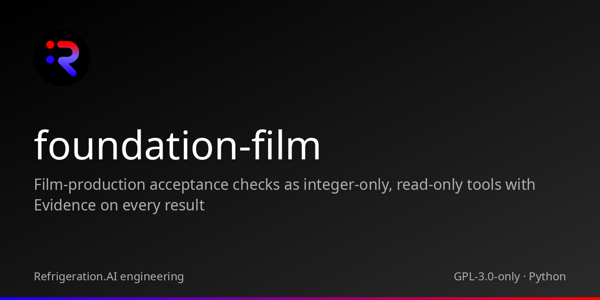

<p align="center"></p>

# foundation-film

Film-production acceptance checks as integer-only, read-only tools with Evidence on every result

 

## Status

Version 0.1.0. 6 read-only tool(s) behind a stdio JSON-RPC bridge, standard library only. Every result carries Evidence and an input hash. A verdict is an observation, not an acceptance decision.

## Quickstart

```
git clone https://github.com/Akilleez-QA/foundation-film
cd foundation-film
python -B -m unittest discover -s tests -t .
python -B tools/build_manifest.py
```

## What is inside

| Tool | Purpose |
|---|---|
| `cinematic_gate` | Per-segment cinematic gate: duration-weighted shot measures (filmstats.py, milli-units) against reference bands (default filmgate.py rules) or explicit rules |
| `reference_bands` | Duration-weighted p25/p50/p75 bands per shot metric, and moving_share, from a measured reference (filmstats.py, milli-units) |
| `audio_gate` | Soundtrack against the mix contract: integrated loudness and true peak (milli-LU/dBTP), voice over bed (milli-dB), share of cuts carrying a hit, AudioSet classes heard, WER per line (per-mille) |
| `drift_verdict` | Clip verdict for control-conditioned generation (I20): per-frame edge F1 and mask IoU, optional depth error and identity similarity (driftgate.py, milli-units) against thresholds, gated on the worst frame; first failing frame and worst-frame summary |
| `cue_vocabulary_check` | Static check of the shared cue vocabulary (I18): ids each lane references against the ids the voice/markers provide (with aliases), per-beat required order and minimum gaps in time |
| `look_gate` | Rejection alarm for the look: per frame, lookgate.py's palette distance, exposure, contrast range, clipping, detail and chroma ratios against an approved target frame (milli-units), every frame against every threshold |

## Measured

23 tests pass with `python -B -m unittest discover -s tests -t .` on Python 3.14.8 (normal and `-O`), at the initial commit. CI: local only.

## Documentation

See [docs/README.md](docs/README.md): requirements, architecture, interface control, verification matrix, configuration management, and the [domain guide](docs/guides/explanation/domain-guide.md).

## Related projects

foundation-film is one of the Foundations. A Foundation owns one domain's meaning, data and acceptance. [POODO](https://github.com/Akilleez-QA/poodo) governs how Foundations are used, and Cstack hosts them: it starts each Foundation's bridge, pins its source manifest and checks every result (see [the ICD](docs/icd/icd-cstack.md)).

| Project | Tie |
|---|---|
| Cstack | Host. Runs this Foundation through a pinned stdio adapter |
| [poodo](https://github.com/Akilleez-QA/poodo) | Governs how Foundations are used |
| [foundation-engine](https://github.com/Akilleez-QA/foundation-engine) | Sibling Foundation |
| [foundation-math](https://github.com/Akilleez-QA/foundation-math) | Sibling Foundation |
| [foundation-refrigeration](https://github.com/Akilleez-QA/foundation-refrigeration) | Sibling Foundation |
| [foundation-robotics](https://github.com/Akilleez-QA/foundation-robotics) | Sibling Foundation |
| [foundation-template](https://github.com/Akilleez-QA/foundation-template) | Sibling Foundation |
| [endoforge](https://github.com/Akilleez-QA/endoforge) | Producers that measure; Foundations judge their outputs |

## Layout

| Path | Contents |
|---|---|
| `foundation_film/` | Domain package |
| `foundation_film_bridge/` | stdio JSON-RPC bridge and schemas |
| `tests/` | Unit and bridge tests |
| `tools/` | Manifest and data tools |
| `docs/` | Requirements, architecture, ICD, verification, configuration, guides |
| `SOURCE-MANIFEST.json` | SHA-256 of every shipped file |

## Contributing

See [CONTRIBUTING.md](CONTRIBUTING.md) and [SECURITY.md](SECURITY.md).

## License

This project is available under the GNU General Public License v3.0 only (GPL-3.0-only). If you want to use it to create a product or service under different terms, commercial licenses are available from Refrigeration.AI. Contact craig@nh3.biz.
