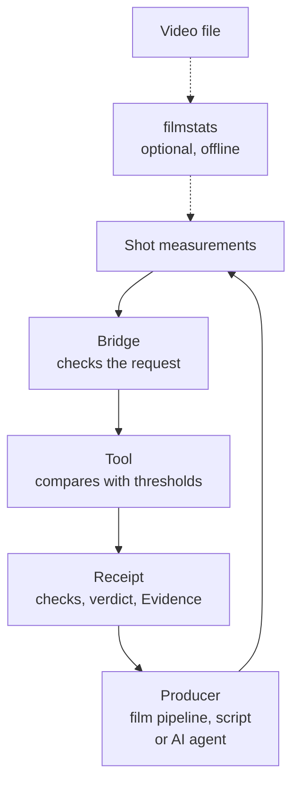

# foundation-film

A read-only checker for film production measurements: shots compared with a reference film, the soundtrack mix, drift in AI-generated clips, cue timing and the look of each frame. It is a *Foundation*: a checker kept separate from the program whose work it judges (see [Where it fits](#where-it-fits)).

[](https://github.com/Akilleez-QA/foundation-film/actions/workflows/ci.yml) 

> [!NOTE]
> **Results are observations, not acceptance decisions.** A pass means the numbers you sent met the stated thresholds. It does not accept a film, a cut or a mix; the client stays the one who accepts delivered work.

## What it does for you

A film pipeline, especially one where AI agents generate or edit shots, produces many numbers: shot lengths, camera motion, loudness, how far a generated clip drifts from its control frames. Someone has to decide whether those numbers are in bounds. Done by eye, that is slow and inconsistent; done by the same agent that made the shot, it is marking your own homework.

This repository is a separate judge. A program sends the measurements it already has, and each check comes back as a value, the allowed range and `pass`, `fail` or `not_measured`, along with **Evidence**: where each threshold came from and whether a qualified person has approved it. The bridge never opens a media file. An optional offline tool can measure shots from a local video for you.

## How it works



The dotted path is optional: `filmstats` measures shots from a video file offline and needs OpenCV. The bridge checks each request's size, integers and message shape. The tool checks its arguments and compares the measurements with thresholds. The receipt carries the checks and verdict, Evidence, the request hash and the boundary flags.

The **bridge** is the small server process your program talks to. It speaks JSON-RPC 2.0 over standard input and output, one message per line. You start it, send `initialize`, then any number of `tools/call` requests, then close stdin. All values cross the wire as integers in thousandths, so results are repeatable: -14200 means -14.2 LUFS, 980 means 0.980, and a field ending in `_permille` uses per-mille (20 means 2 %).

It borrows MCP's method names (`initialize`, `tools/call`) but is not an MCP server, so an MCP client cannot connect to it directly. The protocol is kept small and strict on purpose, so a host can check every message exactly. From your own code, start the bridge as a child process and write JSON lines to it. To give it to an AI agent, run it through a host such as Cstack, or wrap that child process in a tool of your own. There is no pip package; the bridge is the supported interface.

The tool's full answer is called a **receipt**: the checks and verdict plus Evidence, the request hash and fixed boundary flags (`observation_only: true`, `acceptance_decision: false`, `control_action: false`).

## Example

Check a soundtrack against the default **mix contract**, the set of limits a finished mix must meet:

| Measure | What it is | Default limit |
|---|---|---|
| Integrated loudness | How loud the whole mix sounds, in LUFS (EBU R 128) | -16 ± 1 LUFS |
| True peak | The highest signal level, in dBTP | at most -1 dBTP |
| Voice over bed | How much louder dialogue is than the music and effects under it | 12 to 15 dB |
| Cuts with a hit | Share of picture cuts that land on a sound hit | at least 80 % |
| Heard | Sound classes an audio tagger heard (AudioSet labels) | Speech and Music present, no Sine wave |
| Word error rate | Speech recognition compared with the script, per line | at most 5 % |

This mix measured -14.2 LUFS, a -1.5 dBTP peak, voice 13 dB over the bed, a hit on 9 of 10 cuts, speech and music heard, and two lines with 2 % and 3 % word error rate.

In the request each measure is in thousandths or per-mille: `integrated_lufs` -14200 is -14.2 LUFS, `voice_over_bed_db` 13000 is 13 dB, and `wer_permille` 20 is 2 %. Run this from the repository root:

```sh
printf '%s\n' \
  '{"jsonrpc":"2.0","id":1,"method":"initialize","params":{"protocolVersion":"foundation-film-jsonrpc/1"}}' \
  '{"jsonrpc":"2.0","id":2,"method":"tools/call","params":{"name":"audio_gate","arguments":{"integrated_lufs":-14200,"true_peak_dbtp":-1500,"voice_over_bed_db":13000,"cuts":10,"cuts_with_hit":9,"heard":["Speech","Music"],"line_wer":[{"line":"line-1","wer_permille":20},{"line":"line-2","wer_permille":30}]}}}' \
  | python3 -B -m foundation_film_bridge \
  | tail -n 1 | python3 -c '
import json, sys
content = json.load(sys.stdin)["result"]["structuredContent"]
receipt = content["receipt"]
print("assessment:", content["assessment"])
for c in receipt["result"]["checks"]:
    print("  %-24s value %-6s allowed %s..%s  %s" % (c["check"], c["value"], c["min"], c["max"], c["status"]))
print("evidence:", [(e["applies_to"], e["evidence"]["status"]) for e in receipt["evidence"]])
'
```

The bridge writes one reply line per request. `tail -n 1` keeps the tool's reply and drops the reply to `initialize`; the short Python script then prints each check. To see the raw replies, stop the pipeline after the bridge command. (`-B` only stops Python writing `.pyc` files into the checkout.)

Output:

```text
assessment: thresholds_not_met
  integrated_loudness      value -14200 allowed -17000..-15000  fail
  true_peak                value -1500  allowed None..-1000  pass
  voice_over_bed           value 13000  allowed 12000..15000  pass
  cut_hit_share            value 900    allowed 800..None  pass
  heard_required_missing   value 0      allowed None..0  pass
  heard_forbidden_present  value 0      allowed None..0  pass
  worst_line_wer           value 30     allowed None..50  pass
evidence: [('result.checks', 'RECORDED'), ('result.contract', 'CHECK')]
```

What this tells you:

- The mix is 0.8 LU louder than the -15 LUFS ceiling, so the assessment is `thresholds_not_met`. Everything else passes.
- `None` means that side of the range has no limit.
- Each Evidence entry has a status. `RECORDED` means a fact that is simply recorded, here your own measurements. `CHECK` means "still to be checked": a threshold no qualified person, such as a re-recording mixer, has signed off yet. This contract was learned from one earlier production, and no threshold is signed off yet.
- You can send your own `contract` object to override any limit, and the receipt lists what you overrode. See [Override a default](docs/guides/how-to/README.md#override-a-default).

The [tutorial](docs/guides/tutorials/first-check.md) walks through a full session with `drift_verdict`, including a refused request.

## Where it fits

This is one of several **Foundations**: small, read-only checker programs, one per subject area. The program that produced the work (a person's tool, a script, or an AI agent) sends a Foundation its result or question, and the Foundation answers with an observation and the evidence behind it. A Foundation checks and reports but never acts, and it is kept separate from the producer so that nothing marks its own work. [Cstack](https://github.com/Akilleez-QA/cstack) is a host that runs Foundations for AI agents and checks each one's file hashes before starting it, but you don't need Cstack: any program that can start a process and write a line of JSON can use this one.

## Try it

You need Python 3.11 or newer (CI tests 3.12; the suite also passes on 3.11). Nothing is installed; the bridge runs from the checkout and uses only the standard library.

```sh
git clone https://github.com/Akilleez-QA/foundation-film
cd foundation-film
python3 -B -m unittest discover -s tests -t .
```

The last line is `OK (skipped=4)`. The four skipped tests need the optional video libraries. Then paste the example above.

### Measure shots from a video (optional)

`foundation_film.filmstats` detects shots in a video file of your own and measures each one: length, camera motion and visual measures. It needs NumPy, OpenCV and PySceneDetect, which [uv](https://docs.astral.sh/uv/) can fetch for one run:

```sh
uv run --no-project --python 3.12 --with numpy --with opencv-python-headless --with scenedetect python -B -m foundation_film.filmstats sample.avi --fps 8 --width 640 > shots.json
```

The output is a `{"shots": [...]}` object you can send to `reference_bands` or `cinematic_gate`. This tool reads the video, so it runs outside the bridge. See [Measure a local video](docs/guides/how-to/README.md#measure-a-local-video).

## Tools

| Tool | What it answers |
|---|---|
| `cinematic_gate` | Do the shots in each segment fall inside a reference's ranges for sharpness, darkness, subject motion, brightness and share of moving-camera shots (or inside your own rules)? |
| `reference_bands` | What are the typical ranges (25th, 50th, 75th percentile) of each shot measure in a reference you trust? |
| `audio_gate` | Does the soundtrack meet the mix contract: loudness, true peak, voice over music, hits on cuts, sounds heard, word error rate per line? |
| `drift_verdict` | Did an AI-generated clip keep following the guide frames it was generated from? You send per-frame match scores: edge F1 (do the outlines match?), mask IoU (do the object shapes overlap?), and optionally depth error and identity similarity; it judges the worst frame and names the first failing one |
| `cue_vocabulary_check` | Does every cue id used in the edit exist in the shared cue list (directly or by alias), in the right order and with the minimum gaps? |
| `look_gate` | Does each frame still match an approved target frame in palette, exposure, contrast, clipping, detail and colour? |

Every argument, default threshold and result field is in the [tool catalog](docs/guides/reference/tool-catalog.md). [How the checks work](docs/guides/explanation/how-the-checks-work.md) explains each one.

## Limitations

- **Observations, not acceptance decisions.** A verdict judges the numbers you sent. The bridge never opens media, so it cannot tell whether those numbers describe the film they claim to.
- The default rules, mix contract and look thresholds come from one reference production. Most are marked `CHECK` and have not been calibrated on other films.
- No check judges story, performance or taste.
- For broadcast or contract delivery, check against the outlet's own specification and a person's review.

See [Limitations](docs/guides/explanation/limitations.md).

## Learn more

- [Tutorial: your first film check](docs/guides/tutorials/first-check.md)
- [How-to guides](docs/guides/how-to/README.md): override a default, measure a video, change which documents Evidence cites, troubleshoot an error
- [Tool catalog](docs/guides/reference/tool-catalog.md): every argument, range and result field
- [Interface](docs/icd/icd-cstack.md): the bridge protocol, errors and size limits
- [Documentation index](docs/README.md)

## What is inside

| Path | Contents |
|---|---|
| `foundation_film/` | The checks, their default thresholds and the optional `filmstats` video producer |
| `foundation_film_bridge/` | The stdio JSON-RPC bridge and tool schemas |
| `tests/` | Unit and bridge tests |
| `tools/` | Source-manifest, trace and documentation tools |
| `SOURCE-MANIFEST.json` | SHA-256 of every shipped file, so a host can check nothing changed |

## Related projects

- [Cstack](https://github.com/Akilleez-QA/cstack): a host that runs Foundations for AI agents.
- Sibling Foundations: [foundation-robotics](https://github.com/Akilleez-QA/foundation-robotics) (motion physics) and [foundation-refrigeration](https://github.com/Akilleez-QA/foundation-refrigeration) (refrigeration data).
- [foundation-template](https://github.com/Akilleez-QA/foundation-template): the starting point for a Foundation in a new subject.

## Engineering records

Version 0.1.0, not yet tagged. CI runs the tests on Python 3.12 in normal and optimized (`-O`) mode, checks the source manifest and scans for leaked secrets; the latest [test report](docs/verification/reports/README.md) has per-test results. CI runs without the optional video libraries; the [how-to guides](docs/guides/how-to/README.md#run-the-optional-producer-tests) show how to run those tests too.

The project also keeps formal engineering records, organized after NASA software documentation guidance. Most readers never need them. The classification, requirements, design, interface, data dictionary, test plan, verification matrix, configuration management and assurance records are listed under [Engineering records](docs/README.md#engineering-records) in the documentation index.

Contributing: [CONTRIBUTING.md](CONTRIBUTING.md). Security reports: [SECURITY.md](SECURITY.md). Help: [SUPPORT.md](SUPPORT.md).

## License

Copyright 2026 Refrigeration.AI. Licensed under the GNU General Public License v3.0 only (GPL-3.0-only). If you want to use it to create a product or service under different terms, commercial licenses are available from Refrigeration.AI. Contact craig@nh3.biz.
