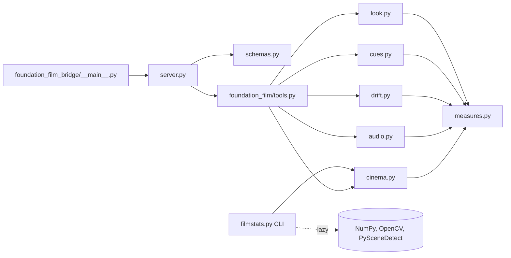
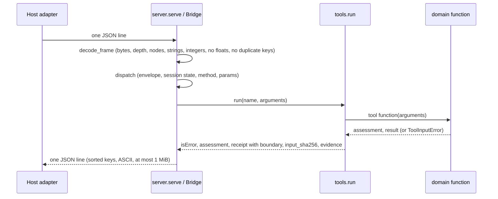

# foundation-film software design description

| Field | Value |
|---|---|
| Document ID | FFILM-SDD |
| Version | 2.0 |
| Status | Draft |
| Owner | Akilleez-QA |
| Date | 2026-11-08 |
| Baseline commit | 852f976aacaf8f08618bd0f37777f37822ce2614 |
| Applies to | foundation-film main at baseline commit |
| Classification | Self-assessed Class E analog; not safety-critical (see SMP §1) |

> Organized after [NPR 7150.2D](https://nodis3.gsfc.nasa.gov/displayAll.cfm?Internal_ID=N_PR_7150_002D_&page_name=all), [NASA-STD-8739.8B](https://standards.nasa.gov/standard/nasa/nasa-std-87398) and the [NASA Software Engineering Handbook](https://swehb.nasa.gov/display/SWEHBVD/7.18+-+Documentation+Guidance) documentation guidance. This is not a NASA compliance determination or certification. The software classification is a self-assessed analog (Class E, not safety-critical); no NASA authority, independent verification and validation, or hazard analysis is asserted. The document describes the implementation inspected at the baseline commit.

## 1. Purpose and design boundary

foundation-film is one Foundation. A Foundation owns the meaning, data and acceptance checks of one domain; here, measurable acceptance checks for film production. POODO governs how it is used. The host (Cstack, through its stdio adapter) starts the bridge, pins its source and validates every result.

Two parts with different boundaries:

- The bridge and the six acceptance tools receive measurements the caller already made and return observations. They never see a film, a frame or a file.
- The optional offline producer (`foundation_film/filmstats.py`) is a separate command line program. It opens a local video, needs NumPy, OpenCV and PySceneDetect, and prints the `shots` argument for the cinematic tools. It is not reachable through the bridge.

## 2. Design decisions and trade-offs

| Decision | Alternatives considered | Rationale | Requirements |
|---|---|---|---|
| Read-only observations with a fixed `boundary` block | Return accept/reject decisions | The client stays the acceptance authority; a verdict is evidence | REQ-FILM-008 |
| Standard library only for the bridge and tools | Share the producer's dependencies | The tool source can be hashed and pinned as a whole; the producer imports its libraries inside functions | REQ-FILM-007, REQ-FILM-011, REQ-FILM-013 |
| Integers only on the wire, in milliseconds and milli-units; integer arithmetic with `div_round` | Floats | Exact input hashes and reproducible verdicts | REQ-FILM-010, REQ-FILM-018 |
| Gate drift on the worst frame | Clip mean | A mean hides a late collapse | REQ-FILM-004 |
| Look gate as a rejection alarm, every frame against every threshold | Acceptance score | A pass means "not rejected", not "approved" | REQ-FILM-006 |
| Parity tests against the reference float rules | Trust the port | The integer port must reproduce the original scripts' outcomes | REQ-FILM-021 |
| Caller overrides named in the result and Evidence | Silent overrides | A caller's calibration must not pass as the Foundation's | REQ-FILM-020 |

## 3. Architecture overview

Static view:

Runtime view (one `tools/call`):

Producer flow: video → content and adaptive shot boundaries (PySceneDetect) → frames sampled at about `--fps` and resized to `--width` → per shot, affine optical flow between consecutive samples (camera class and speeds) and still-image statistics → milli-unit integers → validated by `cinema.shots` → `{"shots": [...]}` on stdout.

## 4. Components

| ID | Path | Responsibility | Inputs and outputs | Requirements |
|---|---|---|---|---|
| C-CINEMA | `foundation_film/cinema.py` | Shot validation, duration-weighted percentiles, default rules from bands, per-segment weighted measures | arguments to verdict per segment or bands | REQ-FILM-001, REQ-FILM-002, REQ-FILM-020, REQ-FILM-021 |
| C-AUDIO | `foundation_film/audio.py` | Mix contract with caller overrides, loudness, peak, voice over bed, cut-hit share, heard classes, WER | arguments to verdict and checks | REQ-FILM-003, REQ-FILM-020 |
| C-DRIFT | `foundation_film/drift.py` | Per-frame series, thresholds with defaults for edge F1 and mask IoU, worst-frame gate, summary | arguments to verdict, first failing frame | REQ-FILM-004, REQ-FILM-021 |
| C-CUES | `foundation_film/cues.py` | Provided ids, aliases, lane references, beat order, minimum gaps | arguments to verdict and lists of breaches | REQ-FILM-005 |
| C-LOOK | `foundation_film/look.py` | Per-frame look checks against default or caller thresholds | arguments to verdict per frame | REQ-FILM-006, REQ-FILM-020, REQ-FILM-021 |
| C-MEASURES | `foundation_film/measures.py` | Shared validation, bounds, `div_round`, `check` and `verdict` | values to validated values or ToolInputError | REQ-FILM-016, REQ-FILM-019 |
| C-TOOLS | `foundation_film/tools.py` | Tool table, Evidence per tool (citation locations from two optional environment variables), input hash, boundary, error capture | name and arguments to isError, assessment, receipt | REQ-FILM-008, REQ-FILM-009, REQ-FILM-010, REQ-FILM-016, REQ-FILM-020 |
| C-SERVER | `foundation_film_bridge/server.py`, `foundation_film_bridge/__main__.py` | Line framing, wire limits, JSON-RPC envelope, session state, response encoding, exit codes | stdin bytes to stdout bytes | REQ-FILM-011, REQ-FILM-012, REQ-FILM-014, REQ-FILM-017, REQ-FILM-018, REQ-FILM-022 |
| C-SCHEMAS | `foundation_film_bridge/schemas.py` | JSON Schema input and output schema per tool; catalog order | none to tool definitions | REQ-FILM-015 |
| C-MANIFEST | `tools/build_manifest.py`, `SOURCE-MANIFEST.json` | Hash the shipped tree; print file count, manifest SHA-256 and inventory SHA-256 | tree to manifest and pins | REQ-FILM-007 |
| C-PRODUCER | `foundation_film/filmstats.py` | Offline shot detection, optical-flow camera class, still statistics, milli rounding, CLI | local video path to shots JSON | REQ-FILM-013 |

`foundation_film/__init__.py` and `foundation_film_bridge/__init__.py` hold only `__version__ = "0.1.0"`.

## 5. Execution concept

- Bridge: one process per session, single-threaded. `serve` reads one line at a time (a line over 65537 bytes including its newline is rejected and ends the session), answers it, flushes, and repeats until end of input. Session state is one flag, `Bridge.initialized`; `ping` and `initialize` work at any time.
- Tools are pure functions of their arguments, except that two optional environment variables, read once at import, change the citation text in Evidence (`FOUNDATION_FILM_PLAYBOOK`, default `docs/PLAYBOOK-film.md`; `FOUNDATION_FILM_PRODUCERS`, default `tools/film/`). The tools never open those locations.
- No timeouts or cancellation inside the bridge. Work per call is bounded by the input limits and array limits (for example 400 shots, 2048 drift frames, 128 look frames). The host owns wall-clock timeouts.
- Producer: one pass over the video, frames held in memory, single-threaded apart from what OpenCV does internally.

## 6. Interfaces

- External: the [Cstack stdio interface](../icd/icd-cstack.md), which also documents the producer command line. Field reference: [tool catalog](../guides/reference/tool-catalog.md), generated from `schemas.py`.
- Internal: `tools.run(name, arguments) -> (isError, assessment, receipt)` is the only call from the bridge into the domain package. The producer calls `cinema.shots` to validate its output.

## 7. Failure handling and containment

| Failure | Handling | Where |
|---|---|---|
| Malformed or out-of-profile frame | JSON-RPC error with `id: null`; session continues | `Bridge.handle` |
| Oversized or unterminated line | One `-32002` error, then exit status 2 | `serve` |
| Bad envelope, method or params | JSON-RPC error; session continues | `Bridge.dispatch` |
| Bad tool arguments | Receipt with `status: error`, `result: null`, Evidence | `tools.run` |
| Unexpected exception | `-32603`, no result | `Bridge.dispatch` |
| Response over 1 MiB or not serializable | Replaced by an error, "Result withheld" | `encode_response` |
| Producer: missing file, incomplete decode, empty shot, bad sampling | Python exception and non-zero exit; no output | `filmstats.measure_video`, `measure_shot` |

Nothing is retried.

## 8. Resource use

Bridge memory is bounded by the 64 KiB input frame and the schema array limits. The bridge writes no files, starts no processes and uses no network. The producer keeps every sampled, resized frame of the video in memory; memory grows with video length times `--fps` times `--width`². Timing has not been measured; no timing claim is made.

## 9. Quality attributes

- Testability: pure functions, parity tests against the reference rules, subprocess-level bridge tests, limit tests at and one past each bound. Counts and results are in the latest [test report](../verification/reports/README.md).
- Security: fail-closed parsing, no caller paths through the bridge, integer-only numbers. See [SECURITY.md](../../SECURITY.md).
- Maintainability: one module per tool; shared validation in `measures.py`.
- Reproducibility: deterministic serialization and a source manifest the host can pin.

## 10. Assumptions and limitations

- Inputs are the caller's measurements; the Foundation cannot check that they came from the film they describe.
- Default rules, contracts and thresholds come from one reference production run and are marked `CHECK` in Evidence where not yet calibrated. See the [defaults](../data/defaults.md).
- A pass is a measured proxy for quality, never the outcome. The client remains the acceptance authority.
- When optical flow finds too few features, the producer records zero motion for that pair, so `static` alone is not proof that motion tracking worked.
- No test validates results against the output schemas (GAP-FILM-07).

## Change history

| Version | Date | Commit | Change | Reviewed in |
|---|---|---|---|---|
| 1.0 | 2026-10-30 | 5c37f74 | Context, components, tools, data flow, decisions | Initial commit |
| 1.1 | 2026-11-01 | e6e6405 | Offline producer | PR #5 |
| 2.0 | 2026-11-08 | 852f976 | Family standard: metadata, decisions, static and runtime views, component IDs with requirements, execution, failure handling, resources, quality attributes, limitations | docs/nasa-standard PR |
